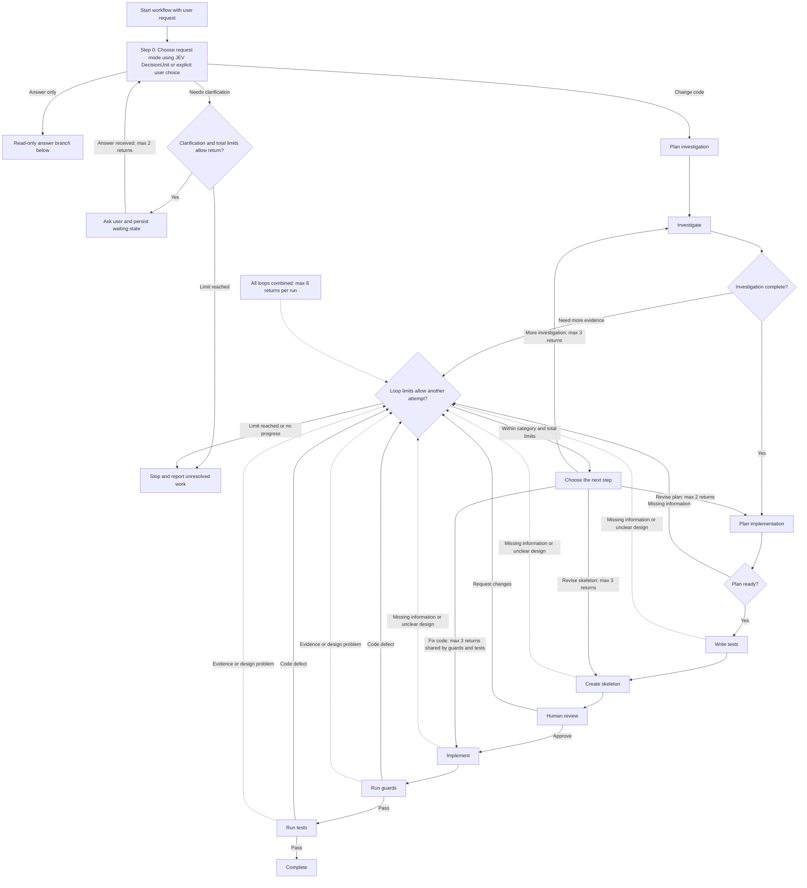
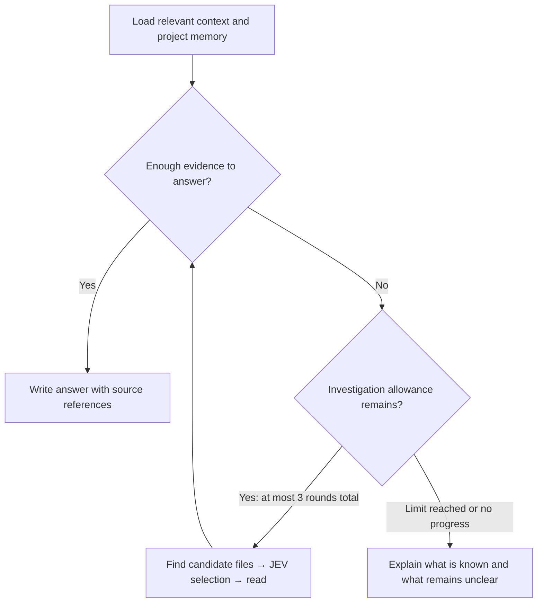

# Coding agent with kushibot

This is the plan for a new coding agent in `kushex/plugins/coding`. This document describes future implementation work.

## Replace the current implementation

Completely remove the current coding-agent code and write the new implementation described here. **Preserve the existing folder structure**, placing the new code in the appropriate folders. Add subfolders when needed.

Continue using kushibot for workflow execution. This replacement applies to the coding plugin, not to kushibot or unrelated Cognition Panel code. No code should be removed as part of writing this proposal.

## One CLI tool in isolated Linux

Expose only the **`cli` tool** to the LLMs. All commands run in an **isolated Linux environment** with a separate project working copy. Each assignment gets only its allowed read, edit, or command permissions. Host services handle memory, artifacts, decisions, and approval outside the model's tool list. See [Tools and Linux environment](tools-and-linux-environment.md).

## Choose between answering and changing code

Add an **answer-only fast path** for requests such as “How does login work?” or “Where are tokens validated?” Requests such as “Fix login” use the full coding workflow below.

Start the workflow in **Step 0: Choose request mode**, inside the kushibot workflow state machine. **Use the JEV DecisionUnit for request classification.** Respect an explicit user choice; otherwise give JEV the request and relevant conversation context to choose `answer-only`, `code-change`, or `needs-clarification`. If intent is unclear, ask a short clarification. A question mark alone does not mean answer-only: “Can you fix login?” requests a change. Save the selected mode for the run.

Save the decision as the step result. Workflow code validates it and activates only the selected branch. If intent is unclear, enter a persisted clarification-wait state, ask the user, and return to Step 0 with the answer. Allow at most 2 clarification returns by default, counted within the total run limit. An unavailable JEV provider is an execution problem, not permission to guess the mode; use bounded retries and report failure if it remains unavailable.

## Every coding stage is a workflow step

**Each numbered stage below is a separate step in a kushibot workflow.** Each step receives input, performs one job, and returns a validated result. Kushibot controls the order, waiting, and correction loops.

The current plugin only has `plan → edit`. The following steps must be implemented in the replacement.

| Step | What it does |
| --- | --- |
| 0. Choose request mode | Inside the workflow, honor an explicit choice or use JEV DecisionUnit to select the answer-only or code-change branch. Wait for clarification when needed. |
| 1. Plan investigation | Decide what to inspect and what must be understood before changing code. The user can select the model for this step. |
| 2. Investigate | Find candidate file names, let JEV select relevant files, then read them and save the findings. Check whether the investigation questions are answered; search again when needed. |
| 3. Plan implementation | Select planning skills and use the investigation findings to decide what to build. Return to investigation if important information is missing. |
| 4. Write tests | Write tests for the planned behavior. The user chooses supported test types and can set a custom test-writing prompt in the UI. |
| 5. Create skeleton | Create proposed files, classes, and method signatures without implementing the methods. |
| 6. Human review | Open a Cognition Panel panel showing the skeleton and wait for approval, requested changes, or cancellation. |
| 7. Implement | Select writing skills and fill in the approved skeleton using the user's selected coding model. |
| 8. Run guards | Run deterministic checks, such as ESLint, and model-based reviews using a separately selected guard model. |
| 9. Run tests | Execute the configured tests and finish only when all required checks pass. |



After a code fix, **repeat guards and tests**. If the design needs to change, return to planning and request approval for the revised skeleton. Limit retries and clearly report unresolved problems.

The diagram shows **proposed configurable defaults**: up to 2 mode-clarification returns, 3 investigation returns, 2 plan revisions, 3 skeleton revisions, and 3 code-fix returns. Guard and test failures share the same code-fix allowance. All categories also share a limit of **8 total returns per run**. These count additional attempts after the first pass, not ordinary forward steps.

Expose **all of these limits in the coding-agent plugin's settings UI**: mode clarifications, investigation returns, plan revisions, skeleton revisions, shared code-fix returns, and total returns per run. The user must be able to change each value. Save the settings for the Cognition Panel project and use a fixed snapshot of them for each run. Validate the values in the backend as well as the UI.

Check and consume the relevant allowance before every return. Save counters with the run; changing steps, restarting a worker, or resuming human review **must not reset them**. Stop earlier if a retry produces no useful progress or the run's time, token, or model-call budget is exhausted. Report the remaining problem without marking the task complete. Continuing beyond a limit requires an explicit user decision and updated limits.

The limit check is workflow code, not an LLM or an extra main step. Use kushibot's bounded transitions and attempt/run budgets, with shared counters for categories that have several return paths. Small assignment retries inside a step also need bounded attempts and must consume the same overall execution budget.

## Answer-only fast path

See [Answer-only fast path: simple explanation](answer-only-fast-path.md) for the short overview and answer format.



The answer-only branch uses read-only investigation and returns a simple explanation. Its behavior, model settings, limits, and answer format are described in the [fast-path document](answer-only-fast-path.md).

## Information checks and return loops

The two main information checkpoints are **after investigation** and **before accepting the implementation plan**. Their job is to ask: “Do we have enough evidence to continue?” Their diamonds represent checks inside those steps. The separate loop-limit diamond checks whether another attempt is allowed. None adds an extra numbered workflow step.

**“Choose the next step” means workflow code decides where to send a request for help.** If the agent needs to understand more files, return to investigation. If the design needs changing, return to planning. If a decision belongs to the user, pause and ask the human through the shared decision capability. This is routing logic, not another LLM or an extra main workflow step. Save the question and the blocked assignment so the agent knows what work to continue after the answer arrives.

Use a focused checker session to review the questions, findings, and source references. Code also checks that required results and evidence exist. The checker returns either `ready` or `needs-information`, naming the exact unanswered question. Later assignments can raise the same request whenever they discover a gap.

| Where a gap is found | Where to return |
| --- | --- |
| Investigation did not answer a question | Repeat candidate discovery → JEV selection → reading for that question |
| Planning needs more knowledge of existing code | Investigation |
| Tests or skeleton need clearer behavior or interfaces | Planning; investigate first if repository facts are missing |
| Implementation needs to understand another API or file | Investigation |
| Implementation needs a different design | Planning, followed by renewed skeleton approval |
| Guards or tests reveal a problem | Implementation for a code defect; investigation for missing evidence; planning for a design problem |

For example:

```text
Implementation asks: Must reset tokens become invalid after use?
  → Save the blocked assignment and question
  → Investigate more files through discovery and JEV selection
  → Save the answer with source evidence
  → Revalidate affected results
  → Continue the blocked work with the new finding
```

Save the unanswered question, why it is needed, the requesting assignment, and evidence already checked. “Investigate more” is not specific enough. If the answer is a product choice rather than something in the repository, use the shared human-decision capability.

In kushibot, make `needs-information` a valid structured step result. Result and acceptance checks validate that report; a workflow transition policy chooses the allowed earlier step. Accepting the report does not mean the original assignment is complete. The model identifies the gap; code controls the return path and prevents forward progress until the gap is resolved.

A backward transition does not automatically resume the exact interrupted assignment. Add saved request and assignment tracking to the runner. After investigation, step input policies pass the new finding to affected work. Preserve completed edits and reuse earlier results only after checking that they are still valid. If the new evidence changes the approved design, revisit planning, tests, skeleton, and human review before implementation continues.

Limit information-gathering rounds as well as code-fix attempts. If repeated searches find no new evidence, stop and report the unresolved question instead of looping forever. An unavailable test environment should be reported as blocked verification, not treated as a reason to rewrite code repeatedly.

## How focused work runs in our workflow

**A workflow step is a container for work. It does not have to be one big LLM conversation.** Inside it, run small assignments in separate kushibot sessions, one after another.

For example, our investigation step should run like this:

```text
Step 2: Investigate
  → Session A: propose file names for one investigation question
  → DecisionUnit: select relevant files using JEV
  → Session B: read selected files and answer that question
  → Code: validate and save the finding
  → Check completeness; repeat discovery if this question remains unanswered
  → Repeat for the next investigation question
  → Return the saved findings to Step 3
```

Session A receives the question and a file listing. It cannot read file contents or edit files. Session B receives the same question and the selected paths, with read-only access to those paths. Neither session receives an assignment to implement the feature.

### Apply this to our nine steps

| Workflow step | Focused work inside it |
| --- | --- |
| 1. Plan investigation | One session produces the questions that must be answered. Its job ends when those questions are accepted. |
| 2. Investigate | For each question: discover paths, select through JEV, then use a separate session to read and explain the relevant code. |
| 3. Plan implementation | Run selected planning skills in dependency order. For example: investigate packages → wait for the user's choice → design using that choice. A final planning assignment assembles the accepted results into one coherent plan. |
| 4. Write tests | Give each session one behavior or related scenario group from the plan. Permit edits only to its test files and fixtures. |
| 5. Create skeleton | Give each session one planned component and its interfaces. Permit declaration-only changes. Check the combined skeleton before review. |
| 6. Human review | Host code waits for the human. No LLM is needed to approve the skeleton. |
| 7. Implement | Give each session one small change from the approved plan, such as a method or related method group. Provide the relevant tests, findings, and interfaces. |
| 8. Run guards | Run each model-based guard with one review responsibility and the necessary code evidence. Run deterministic guards directly as commands or code. |
| 9. Run tests | Execute registered test commands directly. On failure, create a focused repair assignment from the failure report and return to implementation. |

Keep enough shared context to make the parts work together: the goal summary, approved interfaces, relevant preferences, and accepted dependency results. Focus does not mean hiding information needed to do the job correctly.

### Which kushibot pieces do this?

Use the following existing building blocks in the replacement plugin:

| Piece | Its job in focused work |
| --- | --- |
| `WorkflowEngine` and step policies | Choose the main step and pass its required upstream results. |
| `StructuredTaskExecutor` | Run a structured assignment, such as answering an investigation question or producing a design. |
| `WorkspaceEditingExecutor` | Run an editing assignment, such as writing one test group or implementing one approved change. |
| `SessionAgentTaskFactory` | Create a separate session for the assignment. The existing `runtime.createTaskFactory(...)` is the normal single-model entry point. |
| `IAgentSessionBinding` | Supply that session's `instructions`, `input`, `tools`, and `acceptance` check. This is where we give it one job and the capabilities for that job. |
| Result contract and acceptance policy | Check the returned structure and actual evidence before accepting the work. |
| Artifact store | Save the accepted result so another assignment can use it without inheriting the whole conversation. |

For example, an implementation session binding would mean:

```text
instructions: Implement TokenService.validateToken only.
input: Approved signature, expiry rules, relevant tests and source.
tools: cli inside isolated Linux, restricted to reading needed
       files and applying changes only to this method.
acceptance: Check the actual diff stayed within the assignment
            and preserved the approved signature.
```

Tool restrictions must be enforced by code. A file allowlist alone cannot enforce “only this method”; that needs a language-aware edit check. General command tools must not provide another way to edit outside the assignment.

### What we still need to implement

Add a small assignment runner used by the relevant step executors. A reusable LLM skill scheduler in kushibot chooses the next eligible skill; code validates the choice, and the runner executes its focused assignment through the kushibot building blocks above. Other work, such as investigating a question, uses the same runner without needing a skill.

The sequence is:

```text
Choose one ready assignment
  → Build its input, instructions, tools, and result contract
  → Run it in its own session
  → Validate and save the result
  → Start the next assignment
```

This assignment runner is proposed plugin code, not an existing automatic feature of kushibot. Persist completed assignment references and pending questions using the framework's storage and recovery support, so restarting a step does not blindly repeat edits. Keep one active assignment per run and share the run's budget. Separate model choices still need the model-binding integration described below.

If an assignment fails, retry that assignment within its limit. If it needs more information or a changed design, return a structured request and let the workflow route it to investigation, planning, or human review. The model does not choose to expand its own scope.

The full guard and test steps still verify the combined result. These controls constrain the model's work and accepted changes; they do not guarantee what the model thinks internally.

## Investigation and artifacts

During file discovery, the LLM should return only candidate file names. JEV then decides which files are relevant to the investigation questions. Only after selection should the agent read those files and explain what it learned.

Save the investigation plan, file selections, and findings in the artifact store. **Every artifact needs a readable label and a simple explanation of how it relates to the user's goal.** Findings should point to their source files.

Pass these artifacts to later steps so they can use the findings without repeating the whole investigation. Recheck findings when their source files change.

## Skills and configuration

**Store all skill and guard definitions in PostgreSQL, scoped by Cognition Panel project ID and agent type**, for example `(projectId, "coding")`. Load only the definitions for the selected project and agent type. Definitions are managed through the UI rather than requiring code changes. Snapshot their versions for each run so editing a definition does not silently change a running task.

Add **Skills** and **Guards** sections to the coding-agent plugin UI. The user must be able to create, view, edit, enable/disable, and delete definitions. Keep versions referenced by existing runs available for their history.

For a skill, the UI configures its name, purpose, instructions, phases, dependencies, expected result, and automatic/required/off selection. The kushibot scheduler receives these saved definitions.

Skills need a phase setting: planning, test writing, skeleton, or implementation. A skill may apply to several phases. Select the skills for the current phase instead of sending every skill to every model.

Build an **LLM skill scheduler in the kushibot library**, called inside the relevant workflow steps. It receives the goal, current phase, short skill descriptions, dependencies, and completed results. Its LLM chooses which eligible skill should run next. For example: find packages → user chooses a package → design the code → check the design. Code validates the choice and enforces dependencies, required skills, and limits.

Give each substantial skill a focused assignment and check its result before continuing. The same LLM can handle several assignments in separate calls. Short, compatible guidance can stay together in one call. Save completed results and use the shared waiting mechanism when a skill needs a human answer.

The nine main workflow steps remain the same. The scheduler is a reusable library capability; the coding plugin supplies its skills and execution tools. The scheduler model chooses the work, and a separate focused session performs it. Use kushibot's execution and recovery mechanisms. See [LLM skill scheduler in kushibot](skill-scheduler.md).

The UI must support separate model choices for investigation planning, implementation, guard review, and the **skill scheduler**. The host supplies the scheduler's selected gateway and profile to kushibot and pins the choice for the run. Other model-driven steps can have their own selection or inherit a default. All calls, including scheduling decisions, share one run budget.

The UI also selects supported test types and suites. These must map to real commands registered by the host.

Add a **Test-writing prompt** field in the coding-agent settings. The user can view and edit the instructions used when generating tests, for example: “Cover success, invalid input, and boundary cases. Use the project's existing test style.” Save this setting for the Cognition Panel project and pin its value for each run. Apply it to every focused test-writing assignment alongside the plan, selected testing skills, and test-only edit restrictions. This prompt controls how tests are written; registered commands still control how tests are run.

## Guards created in the UI

A guard can run **deterministic code**, use an **LLM review**, or combine both. The user chooses the type when adding a guard in the UI.

For every guard, configure its name, purpose, applicable phases, automatic/required/off selection, and whether findings block completion or are advisory. For an LLM guard, add review instructions and a model selection or inherit the run's guard model.

For a deterministic guard, configure a command with arguments or a script, its working directory, timeout, and success condition. Save these settings in PostgreSQL with the project and agent type. The backend validates and registers the saved configuration; the LLM cannot substitute a different command.

For example, create an **ESLint guard** from the UI with command `npm`, arguments `run lint -- --max-warnings=0`, and success defined as exit code `0`. The project must already provide that lint script and its dependencies in the Linux environment. A missing executable or configuration is a verification error, not a pass.

Execute deterministic guards through the same isolated Linux CLI execution service. No LLM is needed to run them. Capture the real exit status, output, guard version, and code revision as evidence. Guards check source without silently fixing it; fixes return to implementation and are checked again.

If the guard blocks completion and reports a problem, follow the existing bounded repair loop. An incomplete or failed guard execution cannot count as successful verification. Saving a guard in the UI does not run it on the user's host.

## Skeleton approval

Create the skeleton in an isolated working copy. Validate that it contains the proposed structure without new method implementations, while preserving existing code.

The review panel shows the goal, plan, files, class and method signatures, diff, and tests. The human can approve, request changes, or cancel.

Approval applies to the exact version shown. Implementation cannot start without it. A changed design needs new approval. Pending review must survive a Cognition Panel reload or worker restart.

## Skills can report findings or ask questions

Provide one shared capability that any skill can use:

- **Inform:** show findings and continue.
- **Decide:** show findings and choices, pause the current step, and continue after the user answers.

For example, a package-selection skill could say:

> I found Package A and Package B. Package A fits this project better because it meets our needs with fewer dependencies. Which should we use?

Cognition Panel shows the evidence, recommendation, choices, and a field for a written answer. Save the request and answer so the decision survives restarts.

Skill instructions explain **when to ask**. The skill returns a structured decision request, and shared host services handle **displaying, waiting, and resuming**. This does not add another LLM tool: `cli` remains the only exposed tool. A question can happen inside any workflow step; it does not need a separate predefined step.

Respect a package the user has already selected. Ask before substituting another package. Install and manifest-edit tools must check the saved authorization; a model recommendation is not approval.

Use the same waiting and response infrastructure for skeleton review, with a dedicated panel for reviewing code structure.

## Project-based long-term memory in PostgreSQL

**Store long-term agent memory in PostgreSQL, scoped to the project in Cognition Panel.** Every memory record belongs to a Cognition Panel project ID, including saved preferences. Memory must survive new tasks and worker restarts within that project, separately from task artifacts and conversation history.

Examples:

- “Prefer maintained npm packages.”
- “Ask before adding dependencies.”
- “Keep helper methods private inside their class.”

When the agent works on a project, recall only that project's memory. Do not automatically share memories across projects or create user-wide defaults. Use the stable Cognition Panel project ID rather than a folder name, workspace path, or run ID. The backend must enforce project access on memory reads and writes. An explicit instruction for the current task overrides an older preference; ask the user when a conflict remains unclear.

Load relevant project preferences before investigation planning and pass them to the steps that need them. Let the user view, edit, and delete memories in a **Memory** panel for the selected Cognition Panel project.

When a skill asks for a decision, offer **Use for this task** or **Remember for this project**. Show what will be remembered and which project it belongs to. Do not turn a one-time choice or a model's guess into a permanent preference automatically.

Remembering “Ask before adding dependencies” does not enforce it by itself. The tools must still check approval.

Reuse kushibot's memory interfaces, SQL store, validation, and retrieval services. PostgreSQL memory statements already exist. Wire them into the agent, map the authorized Cognition Panel project ID to the memory scope, and add the preference fields and UI. Start with topic-based retrieval within that project; a vector database is unnecessary.

## What kushibot provides and what we must build

| Area | Available foundation | Needed work |
| --- | --- | --- |
| Workflow | Engine, executors, result validation, and bounded correction transitions | Implement the new coding steps, focused assignments, tool restrictions, and their connections |
| CLI execution | Existing CLI and workspace foundations | Provide one CLI tool with enforced assignment permissions inside an isolated Linux environment |
| Answer-only path | DecisionUnit, structured executors, read-only bindings, and investigation components | Add Step 0 with JEV classification, persisted clarification, conditional branch activation, and bounded answer investigation |
| JEV selection | Generic DecisionUnit and provider interfaces | Add the actual JEV provider and file-selection flow; no JEV-specific provider was found in the inspected source |
| Artifacts | Persistent artifact storage and readers | Add labeled investigation findings and pass them between steps |
| Skills | Existing catalog and automatic selection | Add PostgreSQL definitions per project and agent type, UI management, and the reusable LLM scheduler |
| Guards | Shared guard framework and plugin model reviews | Add PostgreSQL definitions per project and agent type, UI management, and deterministic command/script execution alongside LLM review |
| Models | Model gateways and profiles | Bind separate models to steps while sharing the run budget |
| Tests and skeleton | Editing tools and registered checks | Add test-only writing, skeleton validation, and separate guard/test execution |
| Human interaction | Pending/recovery foundations | Add durable questions, approval records, review panels, and authenticated resume actions |
| Memory | Memory services, SQL store, and PostgreSQL statements | Add PostgreSQL memory scoped by Cognition Panel project ID, project-only recall, and a project Memory panel |

The current `Agent.run()` starts a new invocation. Implement reopening and resuming a waiting run explicitly; starting another run is not a resume.

Keep general workflow, memory, and waiting capabilities in kushibot. Keep coding-specific behavior in the plugin. Keep panels and user actions in Cognition Panel. Existing example documents may describe proposed APIs, so verify them against the library source before using them.

## Implementation order

1. Build investigation, JEV selection, labeled artifacts, and the answer-only workflow with request routing.
2. Add UI-managed skills and guards stored in PostgreSQL per project and agent type, the skill scheduler, model settings, and project-based PostgreSQL memory.
3. Add test writing and skeleton generation in an isolated workspace.
4. Add human review and restart-safe resume.
5. Add implementation, guards, tests, and bounded repair loops.

Verify the complete flow, including answer-only routing and read-only enforcement, missing-information loops, return to blocked assignments, searches with no new evidence, rejected skeletons, reloads while waiting, changed approvals, failed guards/tests, and exhausted retries.
